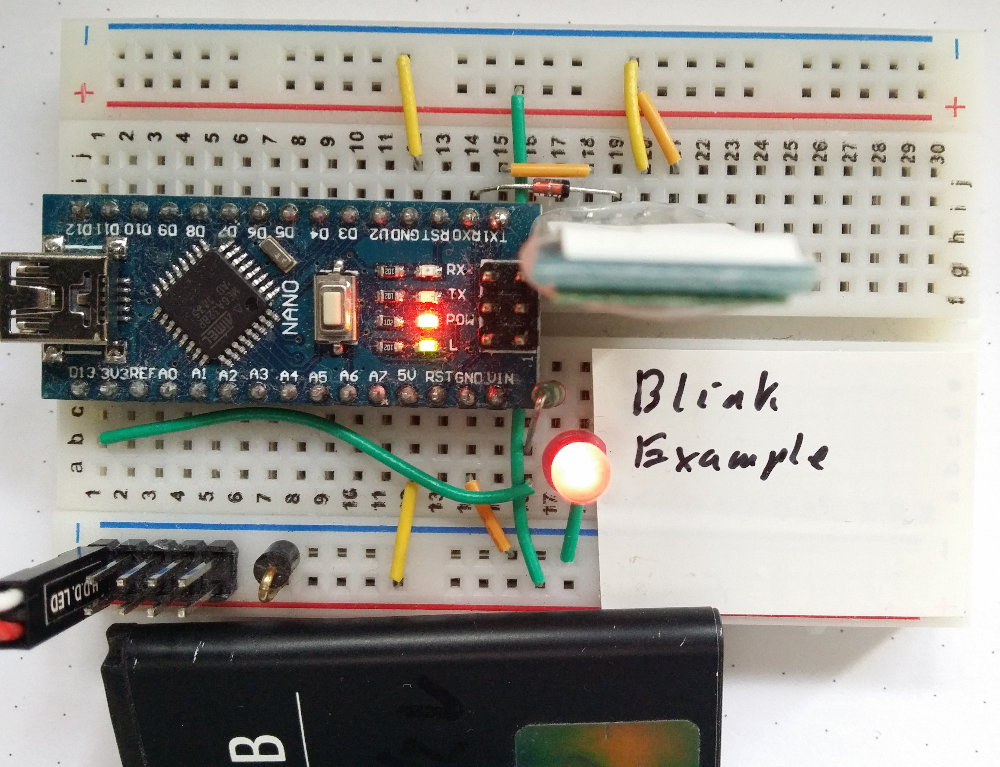
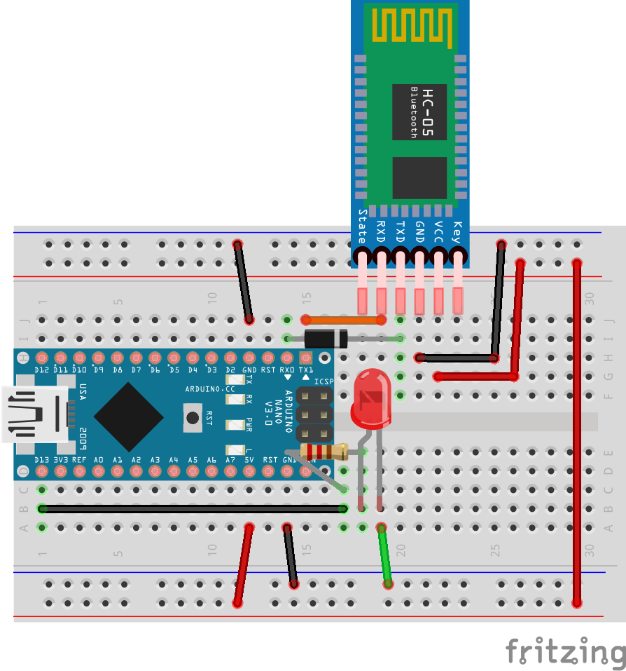
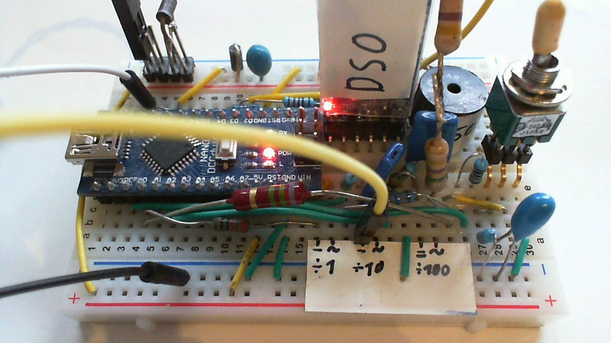
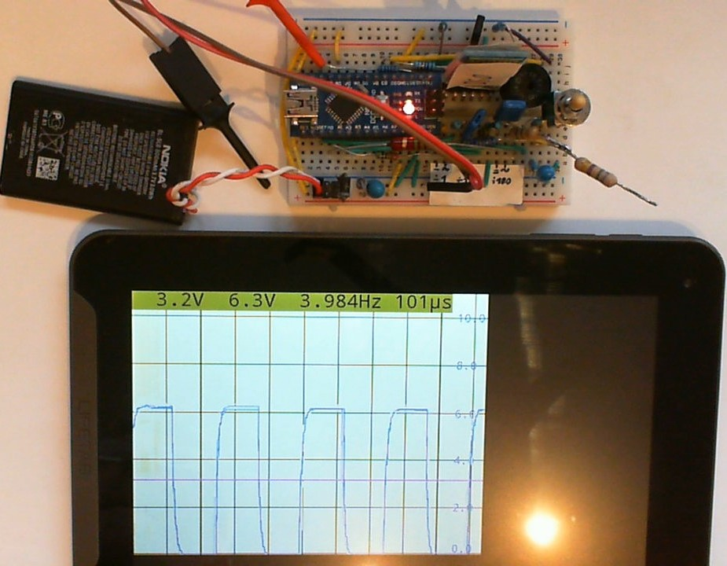
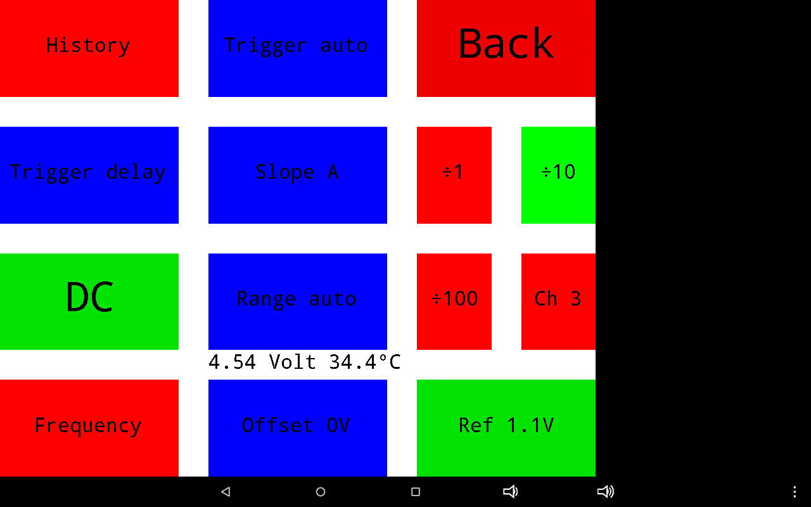
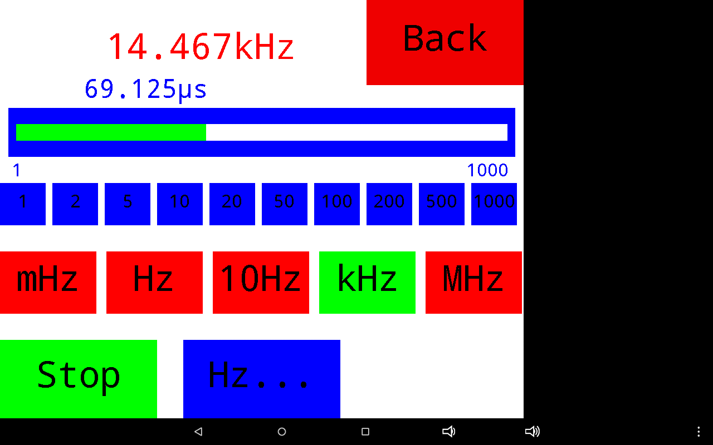
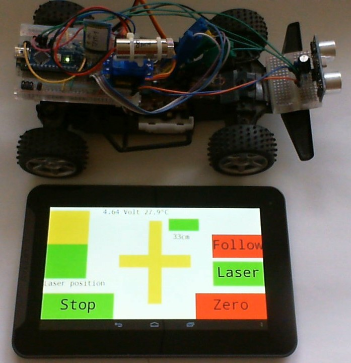
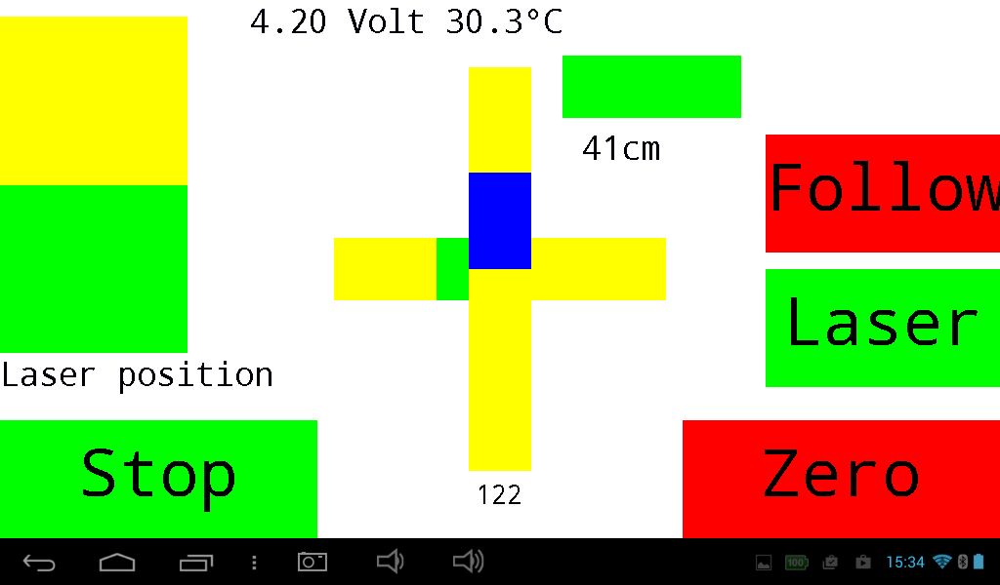

<div align = center>

# [BlueDisplay App](https://play.google.com/store/apps/details?id=de.joachimsmeyer.android.bluedisplay)
Convert your smartphone into an Android remote touch display for your Arduino or ARM projects.

[](https://www.gnu.org/licenses/gpl-3.0)
 &nbsp; &nbsp;
[](https://github.com/ArminJo/android-blue-display/releases/latest)
 &nbsp; &nbsp;
[](https://github.com/ArminJo/android-blue-display/commits/master)
 &nbsp; &nbsp;

<br/>
<br/>
[](https://stand-with-ukraine.pp.ua)


[](https://github.com/ArminJo/android-blue-display?tab=readme-ov-file#revision-history)

#### If you find this app useful, please give it a star.

&#x1F30E; [Google Translate](https://translate.google.com/translate?sl=en&u=https://github.com/ArminJo/android-blue-display)

</div>


# SUMMARY
Let your Arduino sketch create a GUI with graphics, buttons and sliders on your smartphone by simply connecting an HC-05 Bluetooth module to the RX/TX pins of your Arduino.
Connecting the Arduino directly to your smartphone with a USB cable and a USB OTG adapter is also supported.<br/>
The app receives draw requests from the Arduino over Bluetooth or USB and renders them.
GUI callback, touch and sensor events are sent back to the Arduino.
**No Android programming needed!**

<br/>

# Features
- **Graphic + text** output as well as **printf implementation**.
- **Touch button + slider** objects with tone feedback and 16 bit values.
- Draw **charts** from byte or short values. Enables clearing of the last drawn chart.
- **Voice output** with Android TextToSpeech for Android 5.0 (Lollipop) and later.
- **Touch and sensor events** are sent to the Arduino.
- Automatic and manual **scaling of the display region**.
- Sliders can have arbitrary start and end values.
- Buttons can be **Red/Green toggle** buttons with different text for both states.
- Buttons can be **autorepeat buttons** with 2 different repeat rates.
- Easy mapping of any UTF-8 characters like Ohm, Celsius etc.
- Up to **115200 baud** using **HC-05** modules or **USB OTG**.
- **USB OTG connection** can be used instead of Bluetooth.
- Local display of received and sent commands for debugging purposes.
- Hex and ASCII output of received Bluetooth data at **log level** verbose.
- **Debug messages as toasts**.
- Swipe from the left border opens the **options menu**.
- **C++ libraries** for [Arduino and ARM (STM)](https://github.com/ArminJo/Arduino-BlueDisplay).

<br/>

# The Arduino library with many examples can be found [here](https://github.com/ArminJo/Arduino-BlueDisplay).
You can install the library in the Arduino IDE with *Tools -> Manage Libraries...* or *Ctrl+Shift+I*. Use "BlueDisplay" as filter string.
The library includes examples for easy initializing of an HC-05 module and for a simple DSO with 0.3 mega samples/sec.

<br/>

# Usage
Before using the examples, make sure that the Bluetooth module (e.g. the HC-05 module) is paired with your Android device and is visible in the Bluetooth settings.
For full screen applications, the menu is called by swiping from the left edge of the screen. Otherwise, you can call it by touching the area not occupied by the client application (black display area).

## Menu option "show touch position"
The current touch position is shown at the upper left corner in the following format:<br/>
`<IndexOfTouchPointer>|<ActionCode>  <XPositionOnScreen>/<YPositionOnScreen> -> <XPositionForApplication>/<YPositionForApplication>`<br/>
`<IndexOfTouchPointer>` is 0 for a touch with one pointer, 1 for the second touch of a multitouch etc.<br/>
`<ActionCode>` is 0 for DOWN, 1 for UP and 2 for MOVE.

<br/>

# Baud rate
All examples initially use a baud rate of 9600. Especially the SimpleDSO_BlueDisplay example runs smoother with a baud rate of 115200.
For this, activate the line `#define BLUETOOTH_BAUD_RATE BAUD_115200` in the example and deactivate a `#define BLUETOOTH_BAUD_RATE` line for 9600, if there is one.<br/>
**And** change the baud rate of the Bluetooth module, e.g. by using the BTModuleProgrammer example.

<br/>

# Sensor axis for an Arduino application
Android sensor axes are [defined for the **natural screen orientation**](https://source.android.com/devices/sensors/sensor-types), which is portrait for my devices:
- When the device lies flat on a table and its left side is down and right side is up or pushed on its left side toward the right, the X acceleration value is positive.
- When the device lies flat on a table and its bottom side is down and top side is up or pushed on its bottom side toward the top, the Y acceleration value is positive.
- When the device lies flat on a table, the acceleration value along Z is +9.81 (m/s^2).

**The BlueDisplay app converts the axes, so that this definition holds for each screen orientation.**

<br/>

# Example for Hex + ASCII output (on log level verbose)
```
V Hex= 00 4C 13 A5 01 08 00 53 65 74 74 69 6E 67 73 A5
V Asc=     L                 S  e  t  t  i  n  g  s
V Hex= 70 12 00 04 00 00 00 00 00 60 00 34 00 00 F8 0B
V Asc=  p                          `     4
V Hex= 03 00 00 30 21 A5 01 07 00 48 69 73 74 6F 72 79
V Asc=           0  !              H  i  s  t  o  r  y
```

<br/>

# Hints
If you need debug output, you must use the `debug()` functions of the library, since using `Serial.print()` etc. disturbs the communication with the app (we have only one serial port on the Arduino). E.g.
```c++
BlueDisplay1.debug("\r\nDoBlink=", (uint8_t) doBlink);
```

To enable programming of the Arduino while the HC-05 module is connected, use a diode to connect Arduino RX and HC-05 TX.
On an Arduino MEGA 2560, Serial1 (RX1/TX1) is used, so no diode is needed.
```
                 |\ |
   Arduino-RX ___| \|___ HC-05-TX
                 | /|
                 |/ |
```

<br/>

# Pictures and screenshots

| | |
|-|-|
| BlueDisplay example breadboard picture |  |
| Fritzing schematic for the BlueDisplay example |  |
| DSO with passive attenuator on breadboard |  |
| DSO at work |  |
| DSO Fritzing |  |
| DSO schematic |  |
| DSO settings menu |  |
| DSO frequency generator menu |  |
| Hacked RC car |  |
| RC car control display |  |

<br/>

# Revision History
### Version 5.2.0 / 25
- Added slider function `SUBFUNCTION_SLIDER_SET_VALUE_AND_DRAW_SLIDER`.
- Added command `FUNCTION_CLEAR_DISPLAY_AREA_AND_SKIP_OPTIONAL`.
- The long touch down event now contains the index of the touch pointer.
- The GMT offset of the time info event is now sent as signed value in minutes.
- Fixed USB permission request for Android 14 and later.
- Many internal fixes and improvements.
- Use `AudioManager.STREAM_MUSIC` instead of `AudioManager.STREAM_SYSTEM`.
- Recompute slider value printing format for `SLIDER_SET_MIN_MAX` and `SLIDER_SET_SCALE_FACTOR`.
- New function `setButtonsGlobalTouchToneState()`.
- Removed `clearDisplayAndDisableButtonsAndSliders()`, it is now included in `clearDisplay()`. Added `clearDisplayArea()`.

### Version 5.1.0 / 24
- Chart history is deleted on reconnect.
- Improved BLUETOOTH_CONNECT permission request.

### Version 5.0.0 / 23
- Voice output with Android TextToSpeech for Android 5.0 (Lollipop) and later.
- Text Y and X position is the upper left corner of the character.
- Screen orientation flags now also possible in `setFlagsAndSize()`.

### Version 4.4.1 / 22
- Targeted Android 14 / 34.
- Improved Chart and Slider support, minor bug fixes and improvements.

### Version 4.3.3 / 20
- Targeted Android 13 / 33.

### Version 4.3.2 / 19
- Targeted Android 12 / 32.
- Support for new function `disableAutorepeatUntilEndOfTouch()`.
- Added flag `FLAG_SLIDER_VALUE_CAPTION_TAKE_DEFAULT_MARGIN`. Margin is set to RequestedCanvasHeight / 60.
- Improved color handling for Red/Green toggle button.

### Version 4.3.1 / 18
- Fixed permission bug for Android 12 / 32.

### Version 4.3 / 17 - First version built with Android Studio
- New command `FUNCTION_CLEAR_DISPLAY_OPTIONAL` to enable resynchronization of slow displays.
- Bluetooth random delay detection.
- Fixed bug for micro-swipe suppressing.
- Added slider command `SUBFUNCTION_SLIDER_SET_DEFAULT_COLOR_THRESHOLD`.
- Opening the options menu by swipe is now not restricted to full screen and connected state.
- Strings printed with `Serial.print()` are not interpreted, but stored in the log for debug purposes.
- Fixed bug in `FUNCTION_BUTTON_REMOVE`.
- Fixed bug in `SUBFUNCTION_SLIDER_SET_POSITION`.

### Version 4.2 / 16
- Swipe from the left border in application full screen mode opens the options menu.
- Removed unnecessary message on no data received under certain circumstances.
- Added parameter values `*LOCK_SENSOR_LANDSCAPE` and `*LOCK_SENSOR_PORTRAIT` for function `setScreenOrientationLock()`.
- Slider caption handling improved.
- Added short `drawText` functions.

### Version 4.1
- Improved startup. New message if no data is received after connect and part of the screen is inactive/black, to access the options menu.

### Version 4.0
- Connection with USB OTG cable now also possible. In this case no Bluetooth adapter is needed.
- Handling of no input for `getNumber`.
- Slider `setScaleFactor()` does not scale the current value, which is delivered as initial value at `init()`.
- Improved tone volume setting - can be adjusted at the smartphone too. `trim()` for all button caption strings.

### Version 3.6
- Connect, reconnect and autoconnect improved/added. Improved `debug()` command. Simplified Red/Green button handling.

### Version 3.5
- Slider scaling changed and unit value added.

### Version 3.4
- Timeout for data messages. Get number initial value fixed.
- Bug autorepeat button in conjunction with UseUpEventForButtons fixed.

### Version 3.3
- Fixed silent tone bug for Lollipop and other bugs. Multiline text `\r` `\n` handling.
- Android time accessible on Arduino. Debug messages as toasts. Changed create button.
- Slider values scalable. GUI multi touch. Hex and ASCII output of received Bluetooth data at log level verbose.

### Version 3.2
- Improved tone and fullscreen handling. Internal refactoring. Bugfixes and minor improvements.

### Version 3.1
- Local display of received and sent commands for debug purposes.

### Version 3.0
- Android sensors accessible by Arduino.

# Credits
The USB driver library used in this project is [Kai Morich's fork of usb-serial-for-android](https://github.com/kai-morich/usb-serial-for-android).
